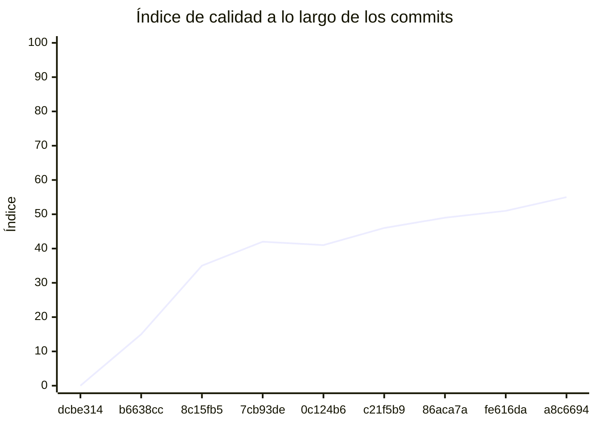

<!-- evaluacion:inicio -->
# Evaluación — mat-gomez/appointment-service

> Documento **generado automáticamente** por la cátedra de Programación II (UM): RepoSense + análisis de calidad de **7 dimensiones**. **No editar a mano**: se regenera en cada evaluación.
> Rama evaluada: `main`. Análisis **heurístico** (regex + métricas) + build: es una criba para orientar la revisión, **no una nota**. La **documentación** del repositorio no se evalúa.
> Generado: 2026-11-11.

## 1. Veredicto

| Aspecto | Resultado |
|---|---|
| Índice de calidad | **52/100** |
| Tipo de repositorio | `backend` |
| Build (`mvnw verify` / `gradlew check`) | no compila |
| Código (LOC) | 1,580 |
| Archivos de código | 48 |
| Clases | 49 |
| Código dentro de clases (%POO) | 75% |
| Funciones fuera de clases | 0 |
| Duplicación (puerta) | 6.6% |
| Duplicación lógica | 7.2% |
| Duplicación de boilerplate | 9.8% |
| Tope duro aplicado a D1 | `POO_BAJO` → D1 ≤ 60 |

> Este informe **describe** lo que el análisis midió con los criterios ya establecidos de la materia. No es una nota.

## 2. Semáforo de aprobación

Criterios de la cátedra (`CRITERIOS-CALIDAD.md`): **Aprobar** se juega con el perfil `estandar`; **destacar**, con el `exigente` (meta de excelencia).

| Semáforo | Resultado |
|---|---|
| Aprobar (`estandar`) | **no cumple** — 5/11 |
| Destacar (`exigente`) | **no cumple** — 3/11 |

**Para aprobar, falta cumplir:** Duplicación; Tests

**Para destacar, falta cumplir:** SOLID; POO; Duplicación; Tests

## 3. Autoría (RepoSense)

| Autor | Commits | Código (LOC) | Tests (LOC) | Docs (LOC) | Días activos | % del código |
|---|---:|---:|---:|---:|---:|---:|
| Melina Abril Gomez Torres | 28 | 866 | 1,158 | 1 | 7 | 100% |

> _El LOC de autoría lo calcula RepoSense sobre el historial y puede diferir del LOC de código del análisis (que mira el estado de `main`)._

## 4. Dimensiones evaluadas

Cada dimensión indica **qué mide**, **por qué importa** y **tu resultado**. Cuando el puntaje queda por debajo de la referencia, se agregan preguntas para **investigar la causa** (no hay recetas).

| Dimensión | Peso | Puntaje |
|:--|--:|--:|
| **D1** Diseño OO, SOLID y patrones (20%) | 20% | 10 |
| **D2** Arquitectura hexagonal — backend (15%) | 15% | 55 |
| **D3** Frontend KMP: MVVM y buenas prácticas (10%) | 10% | N/A |
| **D4** Integración y contrato (10%) | 10% | 40 |
| **D5** Seguridad y robustez (10%) | 10% | 100 |
| **D6** Pruebas y cobertura (20%) | 20% | 40 |
| **D7** Proceso y entrega (15%) | 15% | 100 |

### D1. Diseño OO, SOLID y patrones (20%)

- **Qué mide:** Métricas orientadas a objetos (clases, métodos, campos, cohesión, acoplamiento, herencia) y proxies de SOLID, más patrones de diseño.
- **Por qué importa:** El eje de la materia es el buen uso de la POO y su arquitectura: un diseño con clases claras y poco acopladas es más fácil de entender, probar y cambiar.
- **Tu resultado:** **10/100**
- **Para investigar la causa:**
    - ¿Se pensó el modelo de clases antes de codificar o se agrupó después?
    - ¿Qué clases concentran muchas responsabilidades a la vez?
    - ¿Los colaboradores llegan como parámetros o se crean por dentro?

### D2. Arquitectura hexagonal — backend (15%)

- **Qué mide:** Separación en capas (dominio, puertos de entrada/salida, adaptadores) y dirección de las dependencias del backend.
- **Por qué importa:** Aislar el dominio de la infraestructura permite cambiar la base de datos, el framework o el transporte sin tocar las reglas de negocio.
- **Tu resultado:** **55/100**
- **Para investigar la causa:**
    - ¿El dominio importa framework o detalles de persistencia?
    - ¿Dónde vive la lógica de negocio frente a los controladores?
    - ¿Se definieron puertos para los servicios que se consumen?

### D4. Integración y contrato (10%)

- **Qué mide:** Cumplimiento del contrato de integración de la cátedra (formato de errores, paginación, autenticación, endpoints esperados).
- **Por qué importa:** Los servicios deben poder integrarse entre sí y con la app sin sorpresas; el contrato es lo que hacen cumplir las pruebas de integración.
- **Tu resultado:** **40/100**
- **Para investigar la causa:**
    - ¿Qué endpoints difieren del contrato acordado?
    - ¿Los errores se devuelven con un formato uniforme?
    - ¿La autenticación es consistente entre servicios?

### D5. Seguridad y robustez (10%)

- **Qué mide:** Credenciales embebidas, consultas SQL por concatenación, y presencia de config de entorno; aislamiento de secretos.
- **Por qué importa:** Un secreto en el repositorio o una consulta construida por concatenación son riesgos concretos, no hipotéticos.
- **Tu resultado:** **100/100**

### D6. Pruebas y cobertura (20%)

- **Qué mide:** Cantidad y resultado de pruebas y cobertura de línea (JaCoCo/Kover, Surefire/Failsafe) cuando hay build.
- **Por qué importa:** Las pruebas son la red de seguridad para refactorizar e integrar; la cobertura acota las zonas sin verificar.
- **Tu resultado:** **40/100**
- **Para investigar la causa:**
    - ¿Qué partes del sistema no tienen pruebas?
    - ¿Las pruebas cubren caminos de error o solo el caso feliz?
    - ¿Qué falla al ejecutar la suite completa (no solo la del módulo propio)?

### D7. Proceso y entrega (15%)

- **Qué mide:** Artefactos verificables de proceso/entrega: `compose`, `.env.example`, CI (`.github/workflows/`), `CODEOWNERS` y wrapper de build (`mvnw`/`gradlew`). **No** puntúa documentación.
- **Por qué importa:** Un proyecto que compila, se levanta y se valida solo es más fácil de revisar y de integrar en equipo.
- **Tu resultado:** **100/100**

## 5. Señales detectadas

El análisis encontró las siguientes señales (archivo, sin número de línea a propósito):

**SRP/responsabilidad** (8)
- clase 'RegisterRequestDTO' sin métodos (7 campos): solo datos — `src/main/java/ar/edu/um/appointment/auth/RegisterRequestDTO.java`
- clase 'UserEntity' sin métodos (6 campos): solo datos — `src/main/java/ar/edu/um/appointment/auth/UserEntity.java`
- clase 'LoginRequestDTO' sin métodos (3 campos): solo datos — `src/main/java/ar/edu/um/appointment/auth/LoginRequestDTO.java`
- clase 'AccountDTO' grande (LOC=10, métodos=0, campos=8) — `src/main/java/ar/edu/um/appointment/auth/AccountDTO.java`
- clase 'AccountDTO' sin métodos (8 campos): solo datos — `src/main/java/ar/edu/um/appointment/auth/AccountDTO.java`
- clase 'ReservationProcess' con baja cohesión (29%) — `src/main/java/ar/edu/um/appointment/turnos/domain/ReservationProcess.java`
- método 'ReservationProcess.ReservationProcess' con 6 parámetros — `src/main/java/ar/edu/um/appointment/turnos/domain/ReservationProcess.java`
- clase 'AuthControllerTest' con baja cohesión (29%) — `src/test/java/ar/edu/um/appointment/auth/AuthControllerTest.java`

**DIP/concretos** (19)
- clase 'AuthController' muy acoplada (CBO=15) — `src/main/java/ar/edu/um/appointment/auth/AuthController.java`
- clase 'TokenProvider' muy acoplada (CBO=10) — `src/main/java/ar/edu/um/appointment/auth/TokenProvider.java`
- clase 'AuthService' muy acoplada (CBO=14) — `src/main/java/ar/edu/um/appointment/auth/AuthService.java`
- clase 'AuthService' instancia 4 concretos (CBO=14) — `src/main/java/ar/edu/um/appointment/auth/AuthService.java`
- clase 'SecurityConfig' muy acoplada (CBO=15) — `src/main/java/ar/edu/um/appointment/config/SecurityConfig.java`
- clase 'SecurityConfig' instancia 3 concretos (CBO=15) — `src/main/java/ar/edu/um/appointment/config/SecurityConfig.java`
- clase 'CatalogServiceClient' muy acoplada (CBO=8) — `src/main/java/ar/edu/um/appointment/turnos/infrastructure/client/CatalogServiceClient.java`
- clase 'CatedraAppointmentsClient' muy acoplada (CBO=12) — `src/main/java/ar/edu/um/appointment/turnos/infrastructure/client/CatedraAppointmentsClient.java`
- clase 'CatedraAppointmentsClient' instancia 5 concretos (CBO=12) — `src/main/java/ar/edu/um/appointment/turnos/infrastructure/client/CatedraAppointmentsClient.java`
- clase 'GlobalExceptionHandler' muy acoplada (CBO=8) — `src/main/java/ar/edu/um/appointment/web/errors/GlobalExceptionHandler.java`
- clase 'AuthControllerTest' muy acoplada (CBO=15) — `src/test/java/ar/edu/um/appointment/auth/AuthControllerTest.java`
- clase 'AuthControllerTest' instancia 3 concretos (CBO=15) — `src/test/java/ar/edu/um/appointment/auth/AuthControllerTest.java`
- clase 'AuthServiceTest' muy acoplada (CBO=9) — `src/test/java/ar/edu/um/appointment/auth/AuthServiceTest.java`
- clase 'ReservationStateHelperTest' muy acoplada (CBO=8) — `src/test/java/ar/edu/um/appointment/turnos/infrastructure/persistence/ReservationStateHelperTest.java`
- clase 'ReservationStatusTest' muy acoplada (CBO=8) — `src/test/java/ar/edu/um/appointment/turnos/infrastructure/persistence/ReservationStatusTest.java`
- clase 'CatedraAppointmentsClientTest' muy acoplada (CBO=14) — `src/test/java/ar/edu/um/appointment/turnos/infrastructure/client/CatedraAppointmentsClientTest.java`
- clase 'CatalogServiceClientTest' muy acoplada (CBO=12) — `src/test/java/ar/edu/um/appointment/turnos/infrastructure/client/CatalogServiceClientTest.java`
- clase 'GlobalExceptionHandlerTest' muy acoplada (CBO=10) — `src/test/java/ar/edu/um/appointment/web/errors/GlobalExceptionHandlerTest.java`
- clase 'GlobalExceptionHandlerTest' instancia 3 concretos (CBO=10) — `src/test/java/ar/edu/um/appointment/web/errors/GlobalExceptionHandlerTest.java`

**OCP/type-switch** (1)
- clase 'JwtService' con 1 type-checks — `src/main/java/ar/edu/um/appointment/config/JwtService.java`

**duplicación** (5)
- duplicación lógica: 6.6% · boilerplate: 9.8%
- bloque de 8 líneas repetido 5 veces en src/main/java/ar/edu/um/appointment/turnos/infrastructure/client/CatalogServiceClient.java:37, src/main/java/ar/edu/um/appointment/turnos/infrastructure/client/CatedraAppointmentsClient.java:30, src/main/java/ar/edu/um/appointment/turnos/infrastructure/client/CatedraAppointmentsClient.java:49 — `src/main/java/ar/edu/um/appointment/turnos/infrastructure/client/CatalogServiceClient.java`
- bloque de 8 líneas repetido 5 veces en src/main/java/ar/edu/um/appointment/turnos/infrastructure/client/CatalogServiceClient.java:36, src/main/java/ar/edu/um/appointment/turnos/infrastructure/client/CatedraAppointmentsClient.java:29, src/main/java/ar/edu/um/appointment/turnos/infrastructure/client/CatedraAppointmentsClient.java:48 — `src/main/java/ar/edu/um/appointment/turnos/infrastructure/client/CatalogServiceClient.java`
- bloque de 8 líneas repetido 2 veces en src/test/java/ar/edu/um/appointment/auth/TokenProviderTest.java:14, src/test/java/ar/edu/um/appointment/config/SecurityConfigTest.java:20 — `src/test/java/ar/edu/um/appointment/auth/TokenProviderTest.java`
- bloque de 8 líneas repetido 2 veces en src/main/java/ar/edu/um/appointment/turnos/infrastructure/client/CatalogServiceClient.java:38, src/main/java/ar/edu/um/appointment/turnos/infrastructure/client/CatedraAppointmentsClient.java:103 — `src/main/java/ar/edu/um/appointment/turnos/infrastructure/client/CatalogServiceClient.java`

**hexagonal** (2)
- falta ports/in (hexagonal)
- falta ports/out (hexagonal)

## 6. Evolución por commit

Métricas calculadas sobre el estado de `main` en **cada commit** (9 commits con trabajo), del primero al último. La calidad usa el perfil `exigente`; el aporte de código lo mide RepoSense. El índice puede **bajar** al crecer el proyecto: se acumulan señales.

| # | Fecha | Commit | Autor | LOC | Índice | %POO | Duplic. | Sueltas |
|---|---|---|---|---:|---:|---:|---:|---:|
| 1 | 2026-09-06 | `dcbe314` | Melina Abril Gomez Torres | 0 | 0 | 0% | 0.0% | 0 |
| 2 | 2026-09-10 | `b6638cc` | Ing. Daniel Quinteros | 0 | 15 | 0% | 0.0% | 0 |
| 3 | 2026-10-15 | `8c15fb5` | Melina Abril Gomez Torres | 18 | 35 | 56% | 0.0% | 0 |
| 4 | 2026-10-30 | `7cb93de` | Melina Abril Gomez Torres | 18 | 42 | 56% | 0.0% | 0 |
| 5 | 2026-11-03 | `0c124b6` | Melina Abril Gomez Torres | 79 | 41 | 82% | 0.0% | 0 |
| 6 | 2026-11-03 | `c21f5b9` | Melina Abril Gomez Torres | 87 | 46 | 75% | 0.0% | 0 |
| 7 | 2026-11-03 | `86aca7a` | Melina Abril Gomez Torres | 316 | 49 | 76% | 0.0% | 0 |
| 8 | 2026-11-04 | `fe616da` | Melina Abril Gomez Torres | 1,002 | 51 | 73% | 2.4% | 0 |
| 9 | 2026-11-04 | `a8c6694` | Melina Abril Gomez Torres | 1,580 | 55 | 75% | 6.6% | 0 |

---
_Informe generado por la cátedra. Las dimensiones y umbrales corresponden a `calidad.py` (perfil `exigente`); el semáforo, a `CRITERIOS-CALIDAD.md`. La documentación del repositorio no se evalúa. Ante dudas, revisá el archivo señalado._
<!-- evaluacion:fin -->
